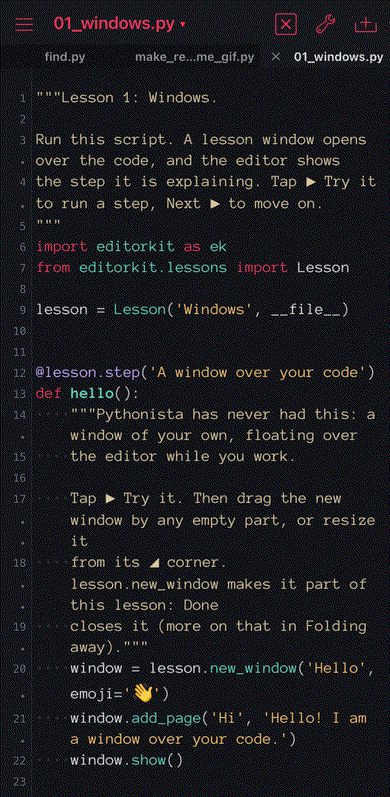

# editorkit

Windows over Pythonista's editor, and the tools I built with them.

That's Lesson 1 running over its own code. Each step explains itself,
selects its code and runs when you tap ▶ Try it.

## Install

Make a new script in Pythonista, paste this in and run it. Run it again
any time to update.

    import urllib.request
    url = ('https://raw.githubusercontent.com/'
           'jackatttack/editorkit/main/install.py')
    source = urllib.request.urlopen(url).read()
    exec(compile(source, 'install.py', 'exec'), {'__name__': '__main__'})

Toolbox appears in the editor's wrench menu. `Documents/Toolbox/Uninstall.py`
takes it all out again.

## Toolbox

The tools I use every day, each opening over your code:

- **Scissors**: select words and lines fast, then move, indent, copy or run them
- **Console**: run the script or just the selection; an error lands as one readable card
- **Explain**: what's the name under the cursor? Plus a search of Pythonista's docs
- **Packages**: pure-Python packages from PyPI, checksums verified, no `setup.py`
- **Files, Find, Snippets, Web** and a few more

Each tool's ? card says how it works.

## editorkit

The library underneath, for your own scripts:

    import editorkit as ek

    ek.annotate(3, 'Check this', style='warning')
    win = ek.Window('Hello', emoji='👋')
    win.add_page('Hi', 'A window over your code')
    win.show()

The best way in is 🎓 Learn in Toolbox: ten lessons from a first window to
a tool of your own in the hub, and a set on Pythonista's ui, scene and
dialogs. [docs/GUIDE.md](docs/GUIDE.md) has the rest, including how to add
your own tools and lessons.

## Good to know

- Made for Pythonista 3.4. Mostly tested on iPhone; iPad works, with rough edges.
- It reaches Pythonista's own classes through `objc_util`, so an app update
  could break something. Please open an issue if it does.
- It only writes to `site-packages-3`, `Documents/Toolbox` and
  `Documents/.editorkit`, and never deletes: anything it replaces goes to
  `Documents/_to_delete`.

MIT licence.
